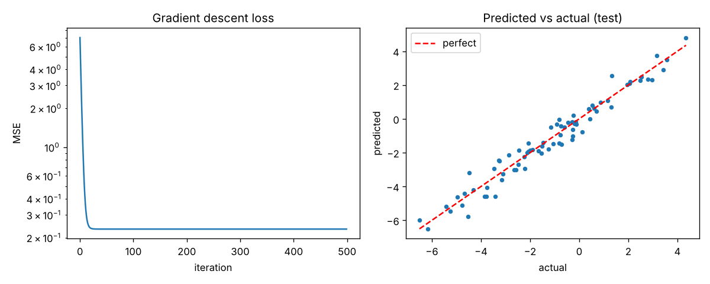
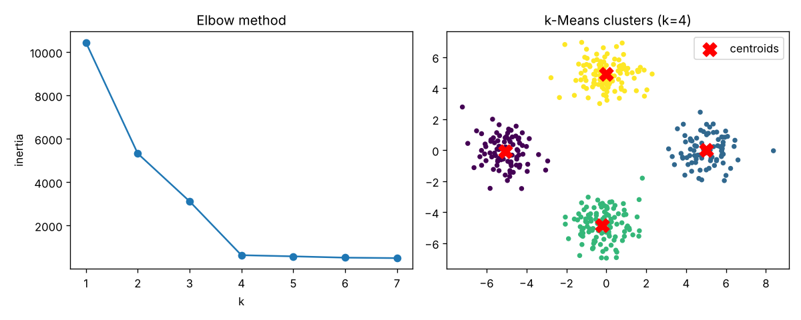
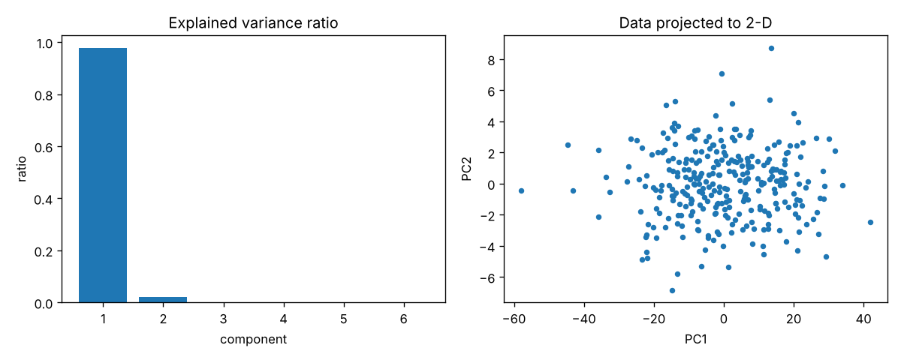
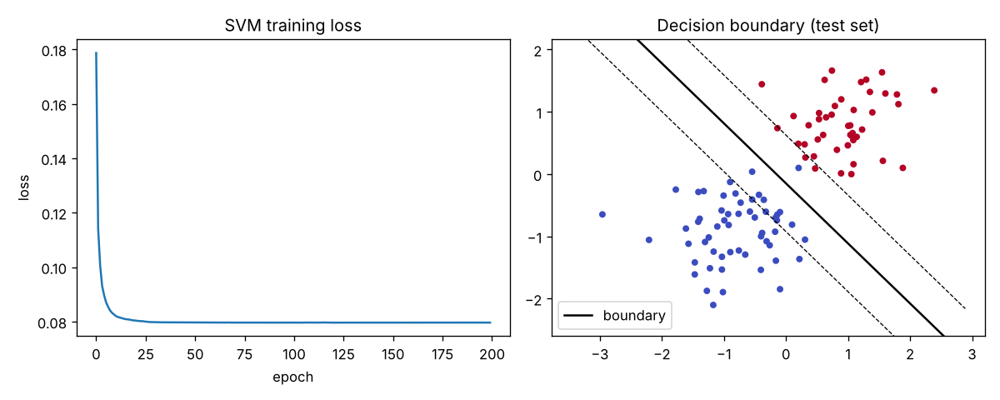

# NumPy ML From Scratch

Classic machine learning algorithms implemented from scratch using only **NumPy**, with tests and a demo that produces plots.

| Algorithm | File | Highlights |
|---|---|---|
| Linear Regression | `mlscratch/linear_regression.py` | Normal equation **and** gradient descent, optional ridge (L2) penalty |
| k-Means | `mlscratch/kmeans.py` | k-means++ initialisation, empty-cluster handling, inertia |
| PCA | `mlscratch/pca.py` | SVD-based, explained variance ratio, inverse transform |
| Linear SVM | `mlscratch/svm.py` | Soft-margin, hinge loss, mini-batch sub-gradient descent |

The goal of this project is to understand how these models work internally instead of calling a library. The results were checked against scikit-learn: the linear regression coefficients, PCA variance ratios and components, and k-means inertia match.

## Quick start

```bash
git clone https://github.com/Payal-ok/numpy-ml-from-scratch.git
cd numpy-ml-from-scratch
pip install -r requirements.txt

python demo.py        # prints metrics and saves plots to images/
python -m pytest      # runs the test suite
```

## Usage

```python
from mlscratch import LinearRegression, KMeans, PCA, LinearSVM
from mlscratch.utils import make_regression_data, train_test_split, r2_score

X, y, _, _ = make_regression_data(n_samples=300, n_features=3)
X_train, X_test, y_train, y_test = train_test_split(X, y)

model = LinearRegression(method="gd", lr=0.1, n_iters=500).fit(X_train, y_train)
print(r2_score(y_test, model.predict(X_test)))
```

```python
from mlscratch import KMeans
from mlscratch.utils import make_blobs

X, _ = make_blobs(n_samples=400, centers=4)
km = KMeans(n_clusters=4, seed=0).fit(X)
print(km.centroids_, km.inertia_)
```

## Results

Output of `python demo.py` on synthetic data:

| Experiment | Result |
|---|---|
| Linear regression (test set) | R² ≈ 0.955, MSE ≈ 0.27; gradient descent converges to the same weights as the normal equation |
| k-Means (4 clusters) | Converges in 2 iterations, inertia matches scikit-learn |
| PCA (6 features) | First 2 components keep 99.9% of the variance |
| Linear SVM (test set) | ≈ 99% accuracy on two Gaussian classes |

Plots are saved in the `images/` folder.






## How the algorithms work (short notes)

- **Linear regression:** the normal equation solves `(XᵀX + αI) w = Xᵀy`. Gradient descent instead repeats `w ← w − lr · ∇MSE` until it converges.
- **k-Means:** repeat two steps: assign each point to the nearest centroid, then move each centroid to the mean of its points. k-means++ picks starting centroids that are far apart, which gives more stable results.
- **PCA:** centre the data, take its SVD, and keep the top right-singular vectors. These are the directions of greatest variance.
- **Linear SVM:** minimise `λ‖w‖² + mean(max(0, 1 − y(w·x + b)))`. Only points inside or on the wrong side of the margin push on the boundary.

## Project structure

```
numpy-ml-from-scratch/
├── mlscratch/
│   ├── __init__.py
│   ├── linear_regression.py
│   ├── kmeans.py
│   ├── pca.py
│   ├── svm.py
│   └── utils.py          # data generators, scaling, metrics
├── tests/test_models.py  # 19 tests
├── demo.py
├── requirements.txt
└── images/
```

## Tests

The 19 tests check things such as:
- Linear regression recovers the true weights; gradient descent matches the normal equation; ridge shrinks weights.
- k-Means recovers well-separated clusters; inertia decreases as `k` grows.
- PCA components are orthonormal; reconstruction with all components is exact; the dominant direction is found.
- The SVM separates two classes; bad labels and bad inputs raise clear errors.

## Possible next steps

- Kernel SVM (RBF)
- Logistic regression and a small neural network
- Cross-validation helper

## License

MIT
